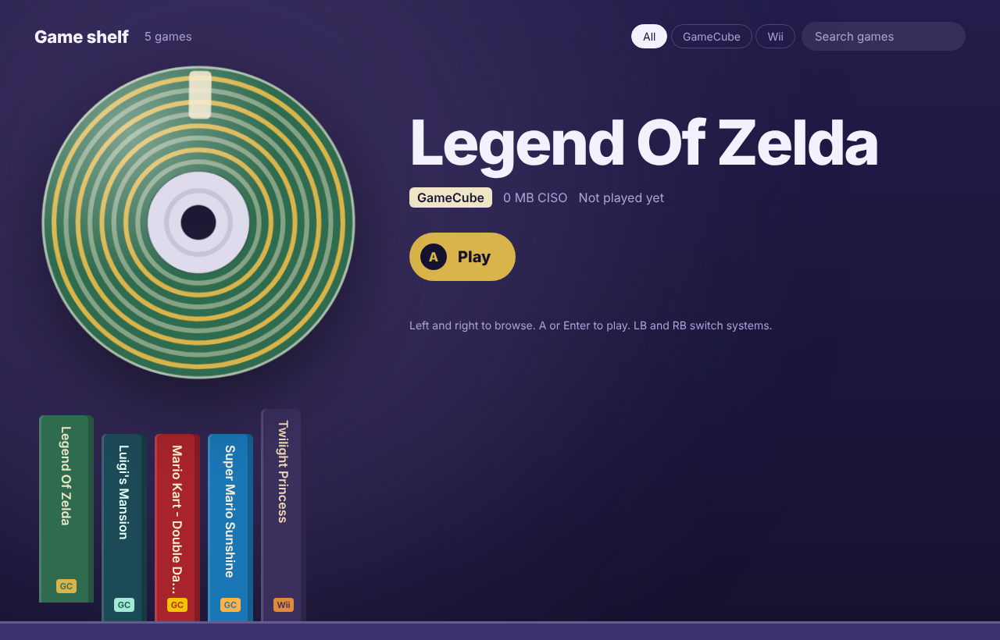

# Game Shelf

A console-style launcher for emulated games on macOS. Your games sit as case spines on a shelf; pick one and its cover, spinning disc and title-screen video take over the screen, then it zooms in and launches fullscreen in the right emulator. Quit the game and you land back on the shelf.



## Features

- **Shelf browsing** with an Xbox/PlayStation controller, keyboard or mouse, with directional slide transitions
- **Covers, discs and looping title-screen backgrounds** (with sound) per game, from files you provide
- **One-click launch** with a zoom-in animation; the emulator opens fullscreen and the shelf returns when you quit
- **Resume** straight into your latest Dolphin save state
- **Per-game controller layouts**, including ready-made Xbox presets, saved as real Dolphin profiles
- **Screenshot gallery** for each game
- **Multi-system**: GameCube, Wii, Wii U, NES, SNES, N64, Game Boy, GBA, Genesis, PS1, PS2, PS3, PSP and original Xbox
- **Tuned launch settings** for Dolphin on Apple Silicon
- Native Mac window (Swift + WebKit), no browser or Terminal needed

## Supported systems

| System | Emulator |
|---|---|
| GameCube, Wii | Dolphin |
| NES, SNES, Game Boy, GBA, N64, Genesis | RetroArch (Nestopia, Snes9x, Gambatte, mGBA, Mupen64Plus-Next, Genesis Plus GX cores) |
| PS1 | DuckStation |
| PS2 | PCSX2 |
| PS3 | RPCS3 |
| PSP | PPSSPP |
| Xbox | xemu |
| Wii U | Cemu |

Emulators are found in an `Emulators` folder next to your games, or in `/Applications`.

## Setup

1. Make a games folder (for example `~/Dolphin Games`) and copy `Game Shelf/` and `Game Shelf.app` into it.
2. Put GameCube and Wii games in the folder itself, and other systems in subfolders named `NES`, `SNES`, `N64`, `Game Boy`, `GBA`, `Genesis`, `PS1`, `PS2`, `PS3`, `PSP`, `Xbox` or `Wii U`. The shelf creates these on first run.
3. Open `Game Shelf.app`. The first launch builds the native window with the Xcode Command Line Tools (`xcode-select --install`), which takes about 30 seconds.

### Folder layout

```
Dolphin Games/
├── Game Shelf.app
├── Game Shelf/
│   ├── launcher.py        # local server, game scanning, emulator launching
│   ├── index.html         # the shelf interface
│   ├── covers/            # <Game Title>.png|jpg|webp
│   ├── discs/             # <Game Title>.png|jpg|webp (photo of the disc)
│   └── backgrounds/       # <Game Title>.mp4|mov (loops behind the game)
├── Emulators/             # optional: emulator apps
├── Your GameCube game.rvz
├── PS2/
└── N64/ ...
```

Name covers, discs and backgrounds after the game title as shown on the shelf.

## Controls

| Action | Controller | Keyboard |
|---|---|---|
| Browse | D-pad / left stick | Left / Right |
| Play | A | Enter |
| Resume save state | X | C |
| Switch system | LB / RB | |
| Sound on/off | Y | M |
| Search | | / |
| Refresh | | R / Cmd+R |

## Note

Game Shelf does not include any games, BIOS files, firmware or artwork. Use games and system files dumped from hardware you own.
